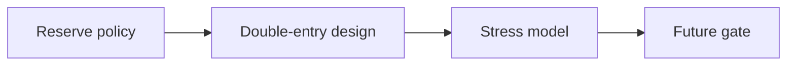

# SYNERGY QE — Monetary Design — научно-техническое досье V5

**Ревизия:** 24.10.2026 · **Партия:** репозитории SYNERGY №68–82 · **Фактический статус:** STUB: README + LICENSE; исполняемых модулей и тестов нет.

> Исходники и наличие тестов проверены по дереву `main`. Это **документационный аудит**, не свидетельство свежего CI, успешного деплоя, воспроизводимого benchmark или экономической прибыли. Старый README сохранён.

## 1. Научная постановка

Формализовать денежную политику, обеспечение эмиссии, погашение, ликвидность и устойчивость при стрессовых изменениях цены.

## 2. Реализация и исследовательская новизна

Текущая версия описывает схему будущих inputs/outputs и угроз, а не работающий денежный механизм. Предлагаемая реализация: double-entry ledger, typed reserve snapshots, bounded monetary controller, deterministic risk gate.

## 3. Математическая формализация

\[A_t=\sum_i q_{i,t}p_{i,t}(1-h_i),\quad L_t=\sum_j \ell_{j,t},\quad \mathrm{coverage}_t=\frac{A_t}{\max(L_t,\varepsilon)}.\]
*Это проектная целевая формула, не реализованный алгоритм.*

Разграничение: формула, реализованная в исходном коде, может быть перепроверена статически; численные результаты и перенос на реальные данные требуют отдельного исполнения с артефактами и независимыми baseline.

## 4. Операционная цепочка



`architecture` описывает поток данных и проектное назначение; автоматически подтверждённой federated runtime-связи отсюда не следует.

## 5. Навигация по проверенным артефактам

- [`README.md`](../README.md)

## 6. Воспроизведение: доступная команда

```bash
# Сейчас отсутствуют build manifest, runtime и test suite.
# Воспроизвести можно только чтение спецификации.
```

Команды приведены как **инструкция для самостоятельного запуска**, они не означают, что тесты были выполнены в рамках данной документационной ревизии.

## 7. Проверяемые гипотезы и acceptance gates

Планируемые: reserve-conservation, depeg/redemption run, stress collateral haircut, adversarial oracle, negative control «эмиссия без внешних активов».

**Граница доказательности:** `SOURCE_PRESENT` и `TEST_SOURCE_PRESENT` отличаются от `TEST_EXECUTED`, `INTEGRATION_VERIFIED`, `DEPLOYED` и `PRODUCTION_READY`. Для повышения статуса нужны command, environment, commit SHA, input manifest, raw output и критерий проверки.

## 8. Угрозы и отказоустойчивость

Self-collateral valuation, reflexive loops, неограниченная эмиссия, liquidity mismatch, риск погашения и внешних обязательств.

## 9. Не доказано / ограничения

Не существует исполнимого QE-движка в текущем `main`; нет обоснования «эмиссии без инфляции» или безрисковой доходности. Лицензия есть, но её наличие не означает готовность продукта.

## 10. Следующий инженерный рубеж

Создать минимальный `src/` + `tests/`, явный balance-sheet schema, event log, reserve policy, четыре stress scenarios и CI, затем провести независимую ревизию.

## 11. Стандарт оформления и история

Досье ориентируется на практику [REVERSE-EXP](https://github.com/Shtenco/dlp_solver) и [SYNERGY SYSTEM](https://github.com/Shtenco/synergy_system): проверяемая постановка, формулы, ссылки на настоящий код, fidelity к реальному зрелости проекта и явные фальсифицирующие тесты. Исходный README и Git-история не удаляются. Четыре охраняемых README экосистемы остаются вне этой партии.
